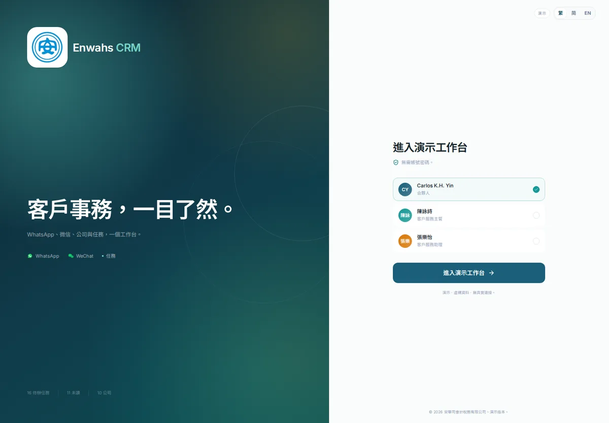
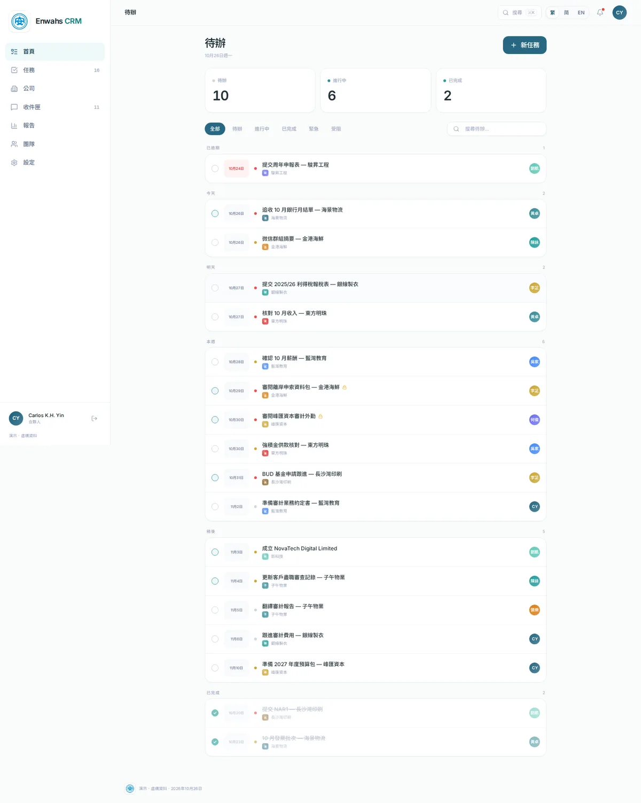
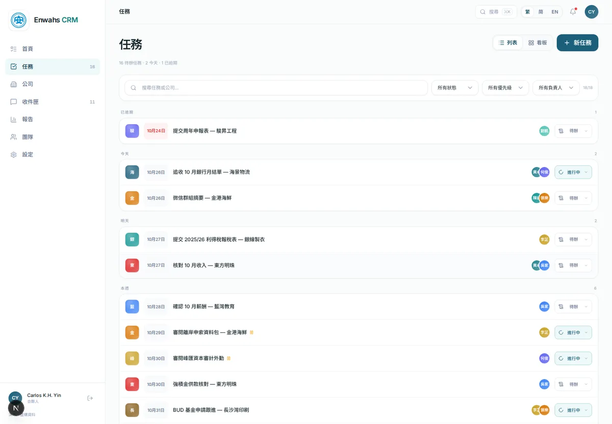
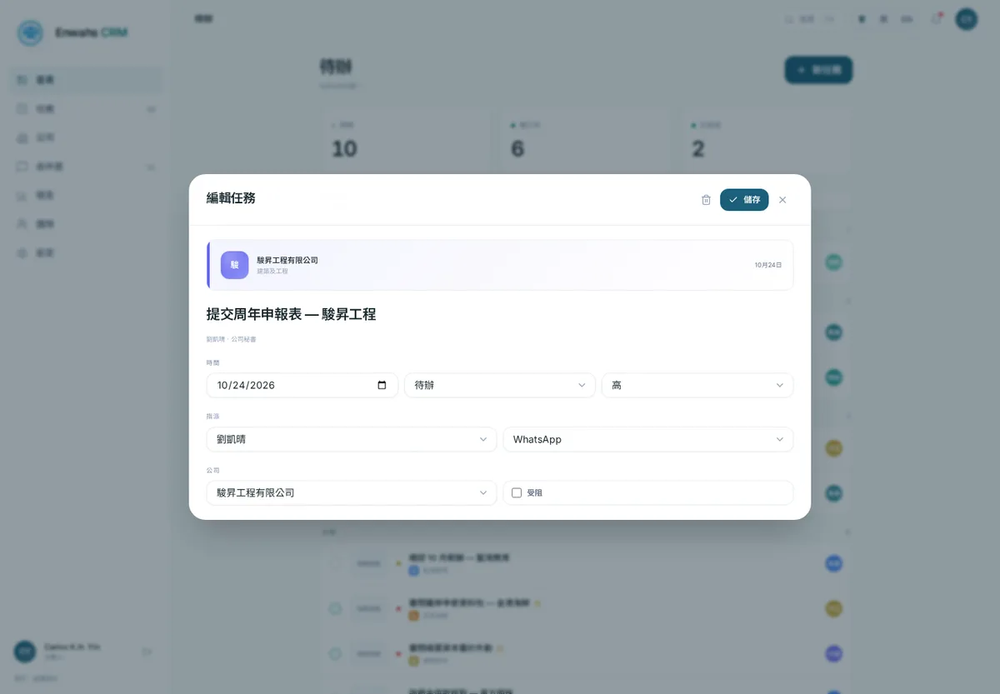

# Enwahs CRM — static demo

A clickable internal workspace demo built for **Enwahs Accounting & Taxation
Limited (安華司會計稅務有限公司)** by **Wankun System**.

The demo shows how the firm could bring WhatsApp and WeChat work, client
company context and open tasks into one calm workspace. It is a **UI demo**:
WhatsApp and WeChat are simulated and read-only, there is no backend, and all
client data is fictional.

[Live demo](https://wankun.kapakki.com/enwahs-demo/) · [Repository](https://github.com/Gameboy612/enwahs-demo)









## What is inside

| Area | What you can do |
|---|---|
| **Login** (`/`) | One-click demo entry; preview as Partner, CS Team Lead or CS Assistant; EN / 繁中 / 简中 |
| **Home** (`/dashboard/`) | Todo agenda with icon filters, count cards, inline state dropdowns, date groups and search |
| **Tasks** (`/tasks/`) | Board-first task screen with a date-grouped List view, filters, quick views, create/edit/delete, multiple assignees with icon roles, checklist progress, drag between columns |
| **Companies** (`/companies/`) | Card and table views, search/filter, add company, health and risk |
| **Company profile** (`/companies/detail/?id=…`) | Contacts, services, open/completed tasks, notes, edit company |
| **Inbox** (`/inbox/`) | Simulated WhatsApp/WeChat threads, AI summary, extracted tasks, one-click task creation, read-only composer |
| **Reports** (`/reports/`) | Throughput, channel mix, volume trend, client health, team workload, CSV export |
| **Team** (`/team/`) | Directory, capacity, workload, assigned tasks, member detail |
| **Settings** (`/settings/`) | Profile, language, notification preferences, JSON export, reset demo data |

The interface is fully trilingual: **English**, **繁體中文** (default) and
**简体中文**. The choice is remembered in the browser.

## Tech stack

- **Next.js 15** App Router with `output: "export"` (fully static)
- **React 19** + **TypeScript**
- **TailwindCSS 3.4** with the Enwahs teal / mint / gold palette
- **lucide-react** icons, custom SVG charts (no chart dependency)
- **GitHub Actions** → **GitHub Pages**
- Local state via `localStorage`; no API, database or secrets

## Quick start

Requires Node.js 20+ and npm.

```bash
npm ci
npm run dev          # http://localhost:3000
```

Other commands:

```bash
npm run typecheck    # TypeScript
npm run data:validate # IDs, dates, translations, placeholders
npm run check        # typecheck + validate + production export
npm run build        # static export to out/
npm run preview      # serve out/ at http://localhost:4173
```

`npm run build` uses `scripts/build.mjs`. On Linux/WSL it preloads a small
`EXDEV` rename fallback so Next's export survives `/mnt/c` DrvFs; GitHub Actions
and normal Linux builds are unaffected.

### Demo date

The dataset is frozen around **26 October 2026** (`DEMO_TODAY` in
`lib/constants.ts`) so server-rendered and hydrated dates always agree. When
refreshing the demo, shift task, thread and note dates together.

### Reset

Changes made in the running demo live only in the browser. Use **Settings →
Reset demo data** to restore the seed dataset and return to the login screen.

## Structure

```text
enwahs-demo/
├── app/
│   ├── page.tsx                 # login
│   ├── login/                   # /login alias
│   ├── not-found.tsx            # Pages 404
│   └── (app)/                   # authenticated workspace shell
│       ├── dashboard/
│       ├── tasks/
│       ├── companies/ + detail/
│       ├── inbox/
│       ├── reports/
│       ├── team/
│       └── settings/
├── components/
│   ├── ui/                      # primitives: button, card, modal, charts…
│   ├── domain/                  # task, company, inbox, report views
│   └── layout/                  # sidebar, topbar, command palette
├── data/
│   ├── seed.ts                  # fictional companies, tasks, threads, team
│   └── analytics.ts             # demo chart series
├── lib/
│   ├── i18n.tsx                 # EN / 繁中 / 简中 strings
│   ├── types.ts
│   ├── demo-store.tsx           # localStorage-backed demo state
│   ├── auth.tsx                 # demo session (no real auth)
│   └── selectors.ts
├── scripts/                     # build wrapper, validation, deploy
├── .dsh/skills/                 # update-data and deploy skills
└── .github/workflows/deploy.yml
```

## GitHub Pages deployment

The repository is configured for Pages at
`https://wankun.kapakki.com/enwahs-demo/` (GitHub's
`https://gameboy612.github.io/enwahs-demo/` redirects to the custom domain).

1. Create the empty GitHub repository `Gameboy612/enwahs-demo` (no README).
2. Add the remote and push `main`:
   ```bash
   git remote add origin https://github.com/Gameboy612/enwahs-demo.git
   git push -u origin main
   ```
3. In **Settings → Pages → Build and deployment**, set **Source** to
   **GitHub Actions**.
4. The `Deploy demo to GitHub Pages` workflow installs, type-checks, validates
   the demo data, builds `out/` with `NEXT_PUBLIC_BASE_PATH=/enwahs-demo`, and
   deploys via the official Pages actions.

The base path is derived from the repository name, so a `<owner>.github.io`
user site gets an empty base path automatically. For a custom domain, set the
repository variable `NEXT_PUBLIC_BASE_PATH` to `none` and optionally set
`NEXT_PUBLIC_SITE_URL` to the custom site origin.
`trailingSlash: true` keeps folder `index.html` files working on Pages, so deep
links such as `/companies/detail/?id=harbourview` can be refreshed directly.

For day-to-day updates:

```bash
bash scripts/deploy.sh
```

The script runs `npm ci`, `npm run check`, commits any source changes and
pushes to `main`, which triggers the workflow.

### Local sub-path check

To reproduce the Pages base path locally:

```bash
NEXT_PUBLIC_BASE_PATH=/enwahs-demo npm run build
# serve out/ beneath /enwahs-demo with any static server
```

## Skills

Two reusable project skills live in `.dsh/skills/`:

- **`update-demo-data`** — how to add companies, tasks, conversations and
  translations, plus the validation and visual QA checklist.
- **`deploy-github-pages`** — repository setup, base-path rules, deployment,
  verification, rollback and troubleshooting.

They are plain `SKILL.md` bundles and are versioned with the project.

## Data and privacy

- Every company, person and message in `data/seed.ts` is **fictional**. Names
  and numbers are invented for demonstration; no real Enwahs client data is
  included.
- WhatsApp and WeChat are represented by read-only simulated threads. The
  project has no WhatsApp/WeChat API integration, no tokens and no sending
  capability.
- Pages is intentionally `noindex` (`robots.txt` and metadata) for the demo.
- Browser storage keys are namespaced under `enwahs-crm-demo-*`; clearing site
  data resets the demo completely.

## Known demo limits

- Login is a client-side demo session, not authentication.
- New companies, tasks and notes persist only in the current browser.
- The company detail route uses a static page plus `?id=` so newly added
  companies still open on GitHub Pages.
- Reports use seeded illustrative figures (volume, AI-handled share) alongside
  live task/company-derived numbers.
- The UI follows the Enwahs light brand theme; there is no dark mode.

---

Built by **Wankun System** for the Enwahs team. Fictional data for
demonstration only.
